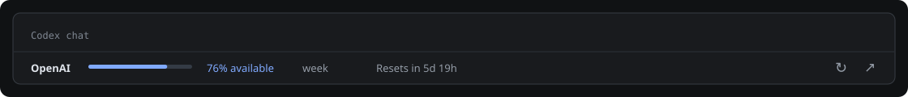

# OpenAI Usage per Herdr

Monitora le quote del tuo abbonamento Codex direttamente in Herdr: una barra nel bordo inferiore di ogni chat mostra percentuale disponibile e tempo al ripristino. Riusa l’accesso ChatGPT della CLI Codex, senza API key aggiuntive.




*Anteprima illustrativa con dati di esempio. La barra reale usa il tema di Herdr e le quote restituite dall’account.*

## Inizia nella nuova app Herdr

Servono Node.js 22 o successivo, Git, la CLI Codex e una versione della app Herdr con supporto a mod e layout personali. Non ci sono dipendenze npm da installare.

```sh
git clone https://github.com/chrimatte/herdr-openai-usage.git
cd herdr-openai-usage
codex login
npm run install:desktop
```

Apri Herdr prima dell’ultimo comando e scegli l’accesso **con ChatGPT** per Codex. L’installazione duplica il layout attivo in `openai-usage` e aggiunge la fascia alta 32 px al bordo inferiore delle chat Codex locali, incluse quelle nuove. Il layout originale resta selezionabile nelle impostazioni. Tieni il checkout: il mod esegue il lettore Node da questa cartella.

Nella barra trovi quota residua, finestra di utilizzo e ripristino. **↻** aggiorna; **↗** apre la pagina utilizzo. Passando sul bordo compaiono i controlli per dividere, espandere e chiudere il pannello. Anche lo stato agente si trova nella fascia inferiore.

Verificato dal vivo su macOS con Herdr app 0.1.13, Codex CLI 0.167.0 e Node.js 26. Il percorso Linux della UI non è stato collaudato dal vivo.

## Herdr da terminale

Il plugin per Herdr 0.9.5 o successivo mantiene l’indicatore compatto sotto le chat:

```sh
herdr plugin link "$PWD"
herdr plugin action invoke local.openai-usage.sync
```

Si apre automaticamente sulle chat Codex rilevate. Comandi, tastiera, configurazione e rimozione sono descritti nella [guida per Herdr da terminale](docs/terminal.md).

## Aggiornamenti e configurazione

La lettura avviene ogni 60 secondi per impostazione predefinita. Le copie della fascia condividono la lettura in memoria. In caso di errore resta visibile l’ultimo dato, segnalato come non aggiornato; i tentativi rallentano automaticamente.

Il file facoltativo `config.json` si trova nella directory restituita da:

```sh
herdr plugin config-dir local.openai-usage
```

Se usi solo la nuova app, il percorso predefinito è `~/.config/herdr/plugins/config/local.openai-usage/`. Copia lì [config.example.json](config.example.json). Puoi modificare intervallo, soglie di colore e percorso di Codex. `autoOpen: false` disabilita la fascia automatica e nuove aperture del plugin da terminale. Gli indicatori da terminale già aperti vanno chiusi manualmente. Vedi la [tabella di configurazione](docs/terminal.md#configurazione-facoltativa).

Per aggiornare i file installati nella app Herdr, dopo un aggiornamento del checkout esegui di nuovo `npm run install:desktop`.

## Dati mostrati e limiti

- Legge le quote Codex/Work disponibili attraverso `codex app-server`, senza generare conversazioni o turni del modello.
- Non misura i messaggi delle normali chat ChatGPT né la spesa delle API OpenAI.
- Non legge file di autenticazione e non salva quote o credenziali su disco. Email e identificativi dell’account non vengono esposti dal monitor.
- Durate e percentuali arrivano dal servizio. Una quota o un ripristino mancanti restano indicati come non disponibili.
- Riassume la finestra con il consumo percentuale più alto. Nella nuova app non attribuisce la quota locale alle chat remote.

Se il monitor non trova Codex, imposta `codexPath`; se manca l’accesso, esegui `codex login` dal terminale. La [guida completa](docs/terminal.md) descrive la vista dettagliata e la gestione degli errori.

## Sviluppo

```sh
npm run check
npm test
npm run demo -- --compact
```

I test usano un app-server simulato e dati sintetici. La CI verifica Node.js 22 e 26 su macOS e Linux; lo stato effettivo è indicato dal badge. Il rendering nativo Herdr richiede anche una verifica nell’app.

Il codice della fascia è in `desktop/`; `src/` contiene lettura, normalizzazione e integrazione da terminale. [CONTRIBUTING.md](CONTRIBUTING.md) descrive struttura, controlli e convenzioni Git.

## Crediti e licenza

Creato da [Christian Matteotti](https://github.com/chrimatte) con il contributo di [Codex](https://github.com/apps/chatgpt-codex-connector), indicato come coautore nei commit pertinenti.

Il progetto non include ancora una licenza d’uso. Non è affiliato a Herdr o OpenAI.
